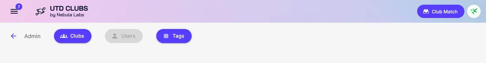
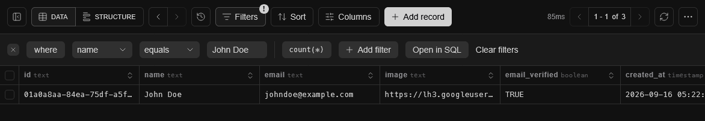
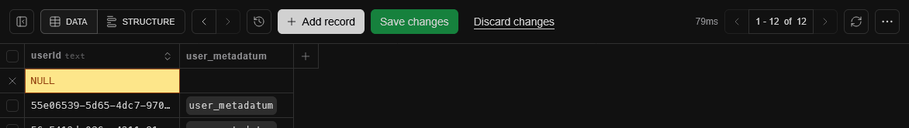

# Admin Features

Hidden behind the `/admin` route, we have tools that make moderating content on the website much easier than having to manually write database queries. This includes managing clubs, their collaborators, users, and club tags.

## How to access admin features?

You might be working on an issue that requires you to change or test an admin feature. This means you'll need to add yourself as an admin on your local branch. **You will only be an admin on your local database branch, meaning you won't be an admin on the production website!**

Follow these steps to add yourself as an admin:

### 1. Sign in to a local version of UTD Clubs

Start the development server for UTD Clubs using `npm run dev`. Make sure you've provided the `DATABASE_URL` environment variable. Now, sign in to UTD Clubs; you'll need an account to add yourself as an admin.

### 2. Open Drizzle Studio

Open another terminal and open Drizzle Studio using `npm run drizzle:studio`. Then, navigate to this page: [local.drizzle.studio](https://local.drizzle.studio). You should see a table covering most of the page, with a list of all the database tables on the left side.

### 3. Obtain your user ID

Navigate to either the `user` or `user_metadata` table in the list on the left side, then find the ID (in the first column) that corresponds to your user account. Copy this ID to your clipboard.

> [!TIP]
>
> Drizzle Studio lets you filter for records. Click the "Filters" button in the top toolbar to add a filter. You could search for your name or email in the `user` table, or your first or last name in the `user_metadata` table.
>
> **Note that filters are case sensitive, and they must be an exact match!** You can find your user account's exact name and email in your [account settings](http://localhost:3000/settings).
>
> 

### 4. Add yourself to the `admin` table

Navigate to the `admin` table in the list on the left side. Click the "Add Record" button in the top toolbar. In the row that appear, paste your user ID in the `userId` column. Finally, click the green "Save changes" button in the top toolbar.

### 5. Try accessing the admin features

Go back to your local version of UTD Clubs. In the sidebar, you should see an item called "Admin". Click on it or navigate to the [`/admin`](https://localhost:3000/admin) route. With any luck, you should see the admin dashboard.

Congratulations! You are now able to work on admin features.
